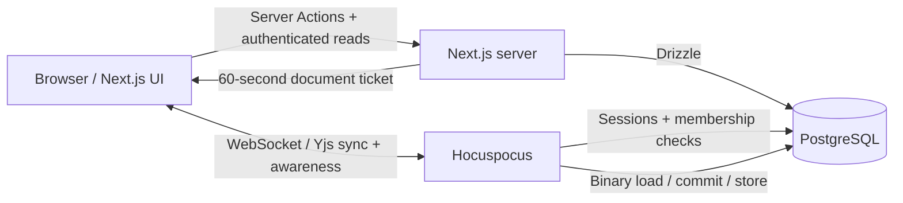
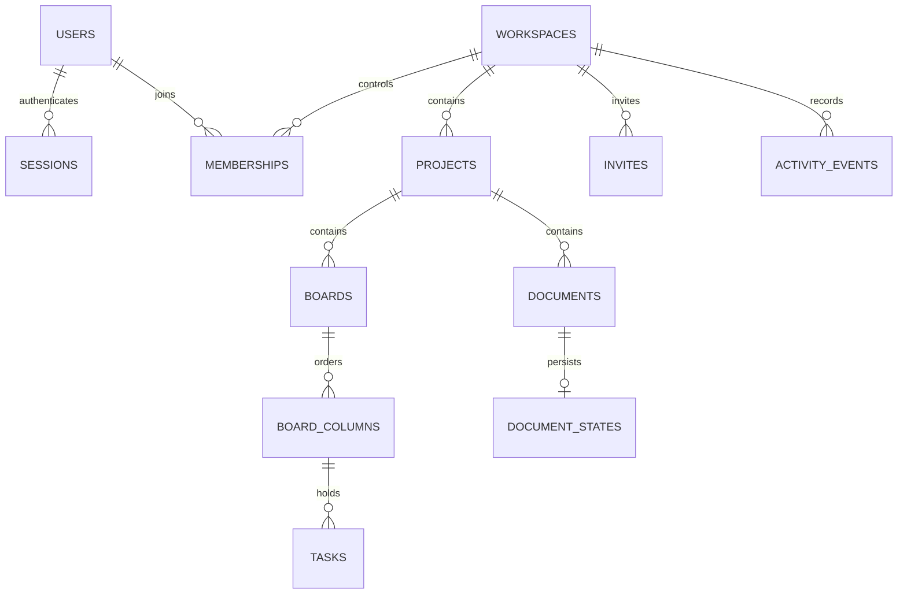

<div align="center">

<sub>A SHARED SPACE · A CLEARER MIND</sub>

# FLOWSTATE

### Good work happens together.

An MIT-licensed, self-hosted workspace for projects, boards, documents and optional GitHub code collaboration.<br />Run your own instance. Keep your data.


[Start locally](#run-locally) · [Architecture](#how-it-fits-together) · [Verification](#verification) · [Security](#security-model)

</div>


## A place for what’s next

Teams need shared context as well as a task list. FLOWSTATE brings projects, boards, and collaborative documents into a membership-controlled workspace. It keeps the MVP focused: concurrent writing, durable content, correct task operations, and explicit permissions.

| Bring the work together                                                            | Keep it in sync                                                                                |
| ---------------------------------------------------------------------------------- | ---------------------------------------------------------------------------------------------- |
| **Workspaces and projects** — create, rename, describe, and delete                 | **Live documents** — Tiptap, Yjs, Hocuspocus, cursors, and presence                            |
| **Kanban boards** — create boards/columns/tasks, edit descriptions, assign members | **Durable editing** — binary CRDT updates committed to PostgreSQL before sync acknowledgements |
| **Useful permissions** — owner, admin, editor, and viewer                          | **Recoverable state** — load/store hooks and a real server-restart integration test            |
| **Invitations** — single-use, email-bound links with 48-hour expiry                | **Practical feedback** — loading, empty, error, connection, and save states                    |

### Code workspace extension

The user-requested extension adds a **Code & GitHub** area to each project: selected-repository connection, branches/commits/PR activity, shared CodeMirror source buffers, explicit branch-and-PR publishing, and a Docker-backed shared terminal. It is separate from the original document-and-Kanban MVP.

**Activation required:** register the GitHub App and provide credentials using [GitHub setup](docs/github-setup.md). Install/start Docker and build the runner image using [Code workspace setup](docs/code-workspace.md). Live GitHub and Docker execution have not been verified on this machine. Automated code-flow tests use a clearly isolated mocked GitHub API.

Creation dialogs now close on successful saves, preserve validation errors, and restore keyboard focus. A newly created board becomes active. Project deletion lives in **Project settings → Danger zone**, with an exact-name confirmation and a separate destructive style.

### Inside the application


<details>
<summary>Mobile workspace</summary>


</details>

Screenshots come from the running application with test workspace content. They are not design mockups. The mobile layout uses compact workspace navigation; boards scroll horizontally and have keyboard-accessible move controls alongside drag and drop.

## The stack

| Layer           | Choice                                                               |
| --------------- | -------------------------------------------------------------------- |
| Web             | Next.js App Router, React, strict TypeScript, Tailwind CSS           |
| Source code     | CodeMirror, Yjs, GitHub App user authorization, xterm, Docker runner |
| Rich text       | Tiptap StarterKit, Collaboration, CollaborationCaret                 |
| Synchronization | Yjs CRDT, Hocuspocus WebSocket server, awareness                     |
| Data            | PostgreSQL, Drizzle ORM and generated SQL migrations                 |
| Identity        | bcrypt passwords, opaque server sessions in HTTP-only cookies        |
| Verification    | Vitest, Playwright, PostgreSQL-backed integration tests              |
| Delivery        | npm workspaces, Docker Compose, GitHub Actions configuration         |

Redis and BullMQ are deliberately omitted: the MVP has no job queue or durable notifications. Presence stays in memory and never becomes document history. One collaboration instance is supported; multi-instance live fanout requires additional infrastructure.

## How it fits together



### The editing path

1. An authenticated user opens a document; the server checks workspace and project membership.
2. A no-store endpoint issues a signed, document-scoped ticket valid for 60 seconds. The HTTP-only session token is never exposed to editor JavaScript.
3. Hocuspocus validates Origin, ticket, live session, membership, and room access. Viewers receive read-only connections.
4. Tiptap edits become Yjs binary updates. Incoming content updates commit atomically before the server applies and acknowledges them. PostgreSQL advisory locks serialize persistence for each document.
5. Clients converge through Yjs. Awareness carries live names, colors, selections, and presence separately from persisted state.
6. Load/store hooks restore binary state. Active sessions are checked on messages and every two seconds while idle. Revoked members lose room access and cannot reconnect.

### The data model



Unique membership pairs and email/slug constraints protect identity and workspace relationships. Sessions and invitations store token hashes. Task updates check a version; moves lock the board and renumber affected columns in a transaction. Document states hold `BYTEA`, save time, and a revision. Membership and task actions produce activity events. `auth_limits` persists authentication throttling windows.

### Repository map

```text
flowstate/
├── apps/
│   ├── web/src/          App Router, forms, boards, editor, authorization
│   └── collaboration/   Hocuspocus authentication and binary persistence
├── packages/
│   ├── database/        Drizzle schema and committed SQL migrations
│   └── contracts/       Shared validation and role capabilities
├── tests/
│   ├── unit/            Validation and capability checks
│   ├── integration/     Real PostgreSQL + WebSocket security/recovery
│   └── e2e/             Accounts, invitations, boards, and two-user editing
├── docs/                Architecture, security, runbook, demo, screenshots
├── infra/docker/        Container build targets
├── .github/workflows/   Checks and container-build configuration
└── docker-compose.yml
```

UI components live in the web app until a second consumer justifies a shared UI package. Server Actions are the internal mutation interface; the document ticket is an authenticated REST endpoint. The blueprint’s example REST routes are not represented as implemented endpoints.

## Self-host FLOWSTATE

Install Node.js 24 and Docker Engine with Compose v2, download the source, then run from the project folder:

```sh
npm run selfhost
```

Open http://localhost:3000 after startup. Setup generates private credentials, starts PostgreSQL, applies migrations and starts the application. Core collaboration requires no GitHub App or cloud database account. Code execution is disabled by default.

```sh
npm run doctor
npm run selfhost:logs
npm run selfhost:stop
```

Stopping preserves the database volume. See the [self-hosting guide](docs/self-hosting.md) for custom ports, HTTPS, backups and optional integrations. Existing development data remains separate. Docker startup still requires verification on a Docker-equipped machine.

## Run locally

Requires Node.js 24 and npm. Docker is optional for local development.

```sh
npm ci
```

Copy `.env.example` to `.env`, and `apps/web/.env.example` to `apps/web/.env.local`. Generate a random secret and put the **same** value in both files:

```sh
node -e "console.log(require('crypto').randomBytes(32).toString('hex'))"
```

In a terminal, start the project-local PostgreSQL instance:

```sh
npm run db:local
```

This uses real PostgreSQL binaries through the development-only `embedded-postgres` package, binds to loopback on port 54329, and persists data under ignored `.local/postgres`. It does not install a Windows service. Keep the terminal open. Use an existing PostgreSQL connection instead by changing both environment files and skipping this command.

Apply migrations, then start the two application processes in separate terminals:

```sh
npm run db:migrate
npm run dev
# Another terminal, from the repository root:
npm run dev:collaboration
```

Open [localhost:3000](http://localhost:3000). Create an account, a workspace, and a project. Create a board and columns, then a document. Invite a teammate from **Members & settings**; sign in with the invited email and reopen the invitation link to join.

### Environment configuration

| Variable                        | Read by                          | Purpose                                                                                   |
| ------------------------------- | -------------------------------- | ----------------------------------------------------------------------------------------- |
| `DATABASE_URL`                  | Both services, migrations, tests | PostgreSQL connection string                                                              |
| `COLLABORATION_SECRET`          | Both services                    | Shared HMAC secret, minimum 32 characters                                                 |
| `COLLABORATION_PORT`            | Collaboration                    | Default `1234`                                                                            |
| `ALLOWED_ORIGINS`               | Collaboration                    | Exact comma-separated browser Origins; default local web Origin                           |
| `NEXT_PUBLIC_COLLABORATION_URL` | Browser, at build time           | Local `ws://localhost:1234`; public deployments require `wss://`                          |
| `POSTGRES_PASSWORD`             | Compose                          | Required database credential; use URL-safe characters or encode URL credentials           |
| `COOKIE_SECURE`                 | Web                              | Production defaults to secure cookies; `false` is set only in loopback-only local Compose |

Next.js reads `apps/web/.env.local`; root scripts read `.env`. Process environment variables override these files. Never commit real credentials. Example credentials are development-only.

### Migrations

```sh
npm run db:generate   # After modifying packages/database/schema.ts
npm run db:migrate    # Apply committed migrations
```

Run migrations once as a controlled deployment step. Do not edit applied migrations. Back up before destructive changes; use a new forward-fix migration when possible. See the [runbook](docs/runbook.md).

### Docker Compose

Use the generated, private `.env.selfhost` configuration:

```sh
npm run selfhost
```

Compose starts PostgreSQL, applies migrations and starts web and collaboration services. Local bindings are loopback-only. See [self-hosting](docs/self-hosting.md) for public HTTPS configuration and verification limits.

## Verification

```sh
npm run lint
npm run typecheck
npm run test
npm run build
npx playwright install chromium
npm run test:e2e
npm run test:code  # Build first; uses an isolated mocked GitHub API
```

Tests require a migrated disposable PostgreSQL database. Integration tests use port 1235. Playwright starts web on port 3000 and collaboration on 1234. Do not point test runs at production. Browser test fixtures persist for screenshot inspection; integration fixtures clean themselves up.

The suites cover capability checks and password byte limits, independent browser accounts, invitation email binding, project persistence, forged viewer writes, workspace isolation, task moves, two-user rich-text convergence, cursor presence, revoked access, binary recovery after a server restart, hostile Origin, and invalid/expired tickets. See [verification details](docs/verification.md) for actual execution status and gaps.

GitHub Actions is configured to run installation, lint, TypeScript, unit/integration tests, build, browser tests, production dependency audit, and container builds. A local pass does not claim that remote CI has run.

## Security model

| Concern             | Control                                                                                                                |
| ------------------- | ---------------------------------------------------------------------------------------------------------------------- |
| Workspace isolation | Server-side membership checks for reads and mutations                                                                  |
| Viewer writes       | Server action rejection and server-enforced read-only Yjs connections                                                  |
| Sessions            | Random 256-bit tokens; only hashes stored; HTTP-only, SameSite cookies; seven-day expiry; Secure cookies in production |
| Passwords           | bcrypt cost 12, minimum 12 characters, explicit 72-byte maximum                                                        |
| Invitations         | Hashed random tokens, matching account email, 48-hour expiry, single-use transaction                                   |
| WebSockets          | Strict Origin checks, signed short-lived tickets, live membership/session checks                                       |
| Revocation          | Checks on every inbound message and two-second idle polling                                                            |
| Resource limits     | 1 MiB inbound WebSocket payload, 8 MiB merged document state, bounded form fields                                      |
| Diagnostics         | No routine document contents or authentication token logging                                                           |

See the [security notes](docs/security/model.md). This is a verified local portfolio MVP, not an independently audited production service.

## Deliberate limits

- One collaboration instance; no Redis fanout or tested horizontal scaling.
- Invitation links are shared manually; no email delivery, password reset, or email verification service.
- Access inherited from workspace membership; no per-document ACL overrides or public sharing.
- Offline edits are not persisted in browser storage. Reconnection works while the page remains open; closing an offline tab can lose unsent changes.
- No block databases, comments UI, search, billing, notifications, advanced version diff, or custom offline conflict UX.
- No measured load targets, production restore drill, public deployment, or remote CI result claimed.
- Authentication limits are per normalized email; production needs deployment-level abuse protection as well.

## Next milestones

1. Verify Compose and the backup/restore runbook on a Docker-enabled host.
2. Deploy in one region with TLS, managed PostgreSQL, monitoring, and restore testing.
3. Measure connection fanout and latency on declared hardware before discussing capacity.
4. Consider the blueprint’s stretch goals only after the core stays reliable: recoverable snapshots, permission-aware search, mentions, and stronger offline support.

The requested sprint is 3–5 days, up to five focused hours per day. See [sprint status](docs/sprint.md); completed features do not imply that several days of work elapsed.

## Contribute and publish

Read [CONTRIBUTING.md](CONTRIBUTING.md). The project is licensed under [MIT](LICENSE).

This repository is local. To publish after authenticating GitHub CLI, run from its root:

```sh
gh auth login
gh repo create flowstate --public --source=. --remote=origin --push \
  --description "An open-source real-time collaborative workspace featuring CRDT-powered document editing, live presence, Kanban task management and permission-aware synchronization."
```

On PowerShell, put the command on one line instead of using the shell continuation above. No successful GitHub push is implied.

<div align="center"><sub>LESS FRICTION. MORE FORWARD.</sub></div>
