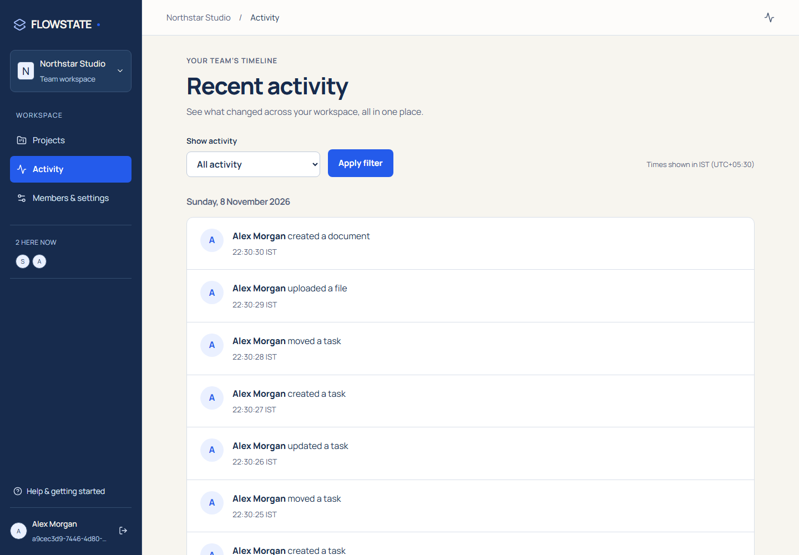
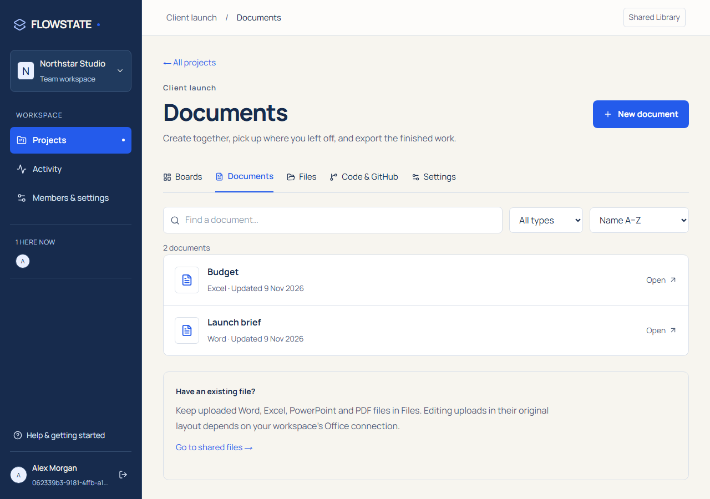

# FLOWSTATE / Version 2

**A little more together.**

This update brings an ivory workspace, navy navigation and bright blue accents,
larger self-hosted Manrope typography, a real landing page at `/`,
document creation without an Office server, and a clearer path from first project
to team collaboration. See the [customer flow](docs/product-flow.md).


## What changed

**Activity now has its own page.** The feed has been removed from the workspace
home and settings. Use Activity in workspace navigation for date groups, type
filters and older/newer history. Existing activity records are preserved.

The interface uses 16px body text, larger labels and controls, and clearer heading
sizes. Electric blue marks buttons, selected tabs, links and important highlights.
The font is served locally; its [OFL license](LICENSES/Manrope-OFL.txt) is included.



Projects now open with optional starter columns. Invitation signup returns to the
team invitation. Assigned tasks link to the right board, Documents has search and
type filters, and project navigation stays consistent across every work area.
In-app help explains how to finish and share the work.

| Update                | What you can do                                                                                                                                                                                |
| --------------------- | ---------------------------------------------------------------------------------------------------------------------------------------------------------------------------------------------- |
| **A new studio**      | Use a light workspace with clear navigation, real task summaries, team notes and live presence.                                                                                                |
| **Review together**   | Comment on code sessions, suggest changes, approve or reject them, and apply approved suggestions with stale-buffer protection. Owners and admins review; editors propose.                     |
| **Work with files**   | Create Word documents, spreadsheets, slide decks and PDF pages in FLOWSTATE. Download DOCX/XLSX/PPTX files or print to PDF. Original-layout editing of uploaded Office files remains optional. |
| **Build together**    | Connect a public repository URL without App setup, edit a shared copy and download saved files. Private access and GitHub publishing use the authorized GitHub App flow.                       |
| **A useful terminal** | Run code in an isolated local Docker container, review tracked text changes, import them into shared buffers and confirm GitHub publishing in the browser.                                     |
| **Clearer controls**  | Successful dialogs close; failed forms retain their draft. Project deletion stays in settings, with confirmation.                                                                              |
| **Public pages**      | A landing page at `/`, a separate `/app` entry, Privacy and Terms pages, metadata and indexing controls.                                                                                       |




[Live document editor](docs/screenshots/editor-desktop.png) · [Document library on mobile](docs/screenshots/documents-mobile.png)

<details>
<summary>Mobile studio</summary>


</details>

Screenshots show the running application with synthetic team content. The landing
page includes an explicitly labelled illustrative workspace preview.
[Native document creation and limits](docs/native-documents.md) · [Spreadsheet](docs/screenshots/spreadsheet-desktop.png) · [Presentation](docs/screenshots/presentation-desktop.png)
[Public introduction](docs/screenshots/about-desktop.png) · [Public page on mobile](docs/screenshots/about-mobile.png)

## Try this version

Requires Node.js 24 and PostgreSQL. Use the [local development instructions](docs/local-development.md)
or the [Docker setup](docs/self-hosting.md). Existing instances must apply migrations
through **0009** before starting version 2.

```sh
npm ci
npm run db:migrate
npm run dev
# In another terminal:
npm run dev:collaboration
```

Open [localhost:3000](http://localhost:3000). The landing page is at `/`; signed-in workspaces start at `/app`. Copy `.env.example` and configure local
credentials first; the setup guide explains both native and container options.

New native documents and public GitHub copies work without those integrations.
Private GitHub access/publishing, original-layout uploaded-file editing, and
terminal execution need their configured services:
[GitHub setup](docs/github-setup.md) · [Office setup](docs/office-editing.md) ·
[Code and terminal setup](docs/code-workspace.md).

## Verification

The release uses TypeScript, ESLint, Vitest, Playwright, PostgreSQL-backed integration
tests, real Docker runner tests and a real ONLYOFFICE CI job. See the
[execution evidence and limits](docs/verification.md) for exact results.

The light landing, Privacy and Terms pages measured **98 performance, 100 SEO,
100 accessibility and 100 best practices** in a local production audit. Axe
reported zero WCAG A/AA violations on those pages. See the
[verification record](docs/verification.md). These are measured results, not a
guarantee for every host or a claim that private pages should be indexed.

```sh
npm run typecheck
npm run lint
npm run format:check
npm test
npm run build
npm run test:e2e
npm run test:code
npm run test:office
# With the production web server running on port 3004:
npm run audit:site
```

## Before demonstrating

- Email/password accounts and manually shared invitation links are implemented. Email delivery, verification and password reset need a separate provider.
- Native documents export without an Office service (8 MiB per download). With the Office service configured, uploaded files save back after all editors close; close editors and wait before exporting. Original uploads, saved versions and Office PDF exports are limited to 4 MiB; file history shares the 100 MiB project quota.
- Suggestions support existing text files up to 64 KiB. Reviews are an optional workflow alongside live editing, not an enforced GitHub merge policy. Pause editing while applying a suggestion; conflicting live edits need a fresh review.
- The terminal supports tracked UTF-8 file imports, not new/deleted files or arbitrary packages requiring internet. Docker is required for execution.
- Actual GitHub App credentials, hosted storage and Sentry delivery are not activated in the local demo. No paid hosting was purchased. AI is deferred by choice.

This is a **public-source portfolio project**, not an open-source contribution
program. See [LICENSE](LICENSE), [privacy policy](apps/web/src/app/privacy/page.tsx)
and [project feedback](CONTRIBUTING.md). Earlier MIT-licensed copies retain their
original rights; dependencies keep their own licenses.
