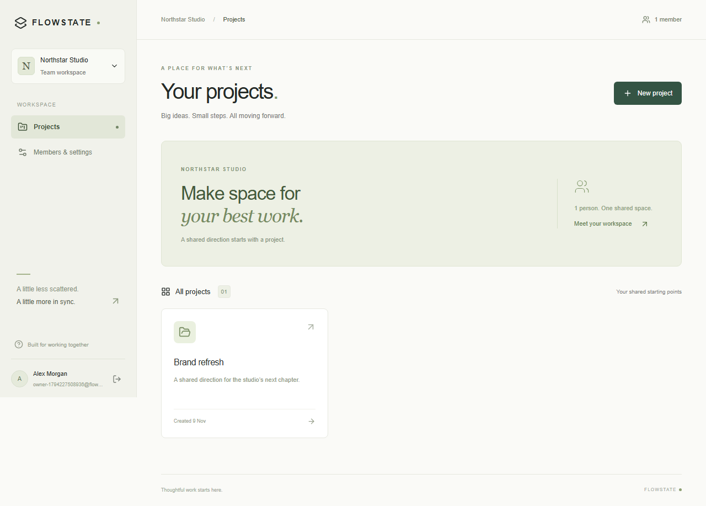
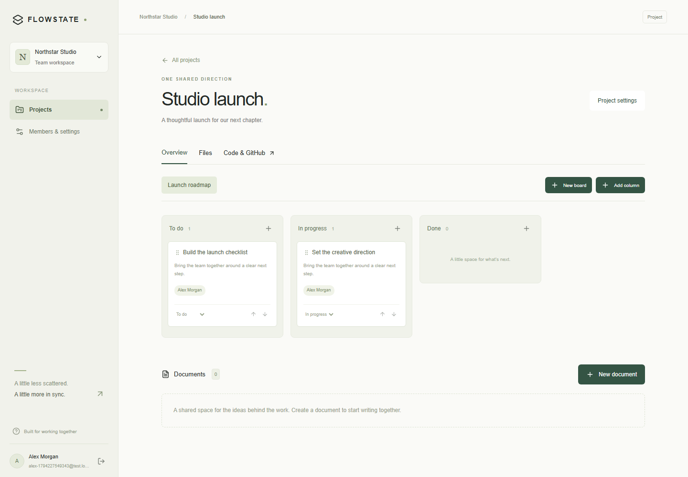
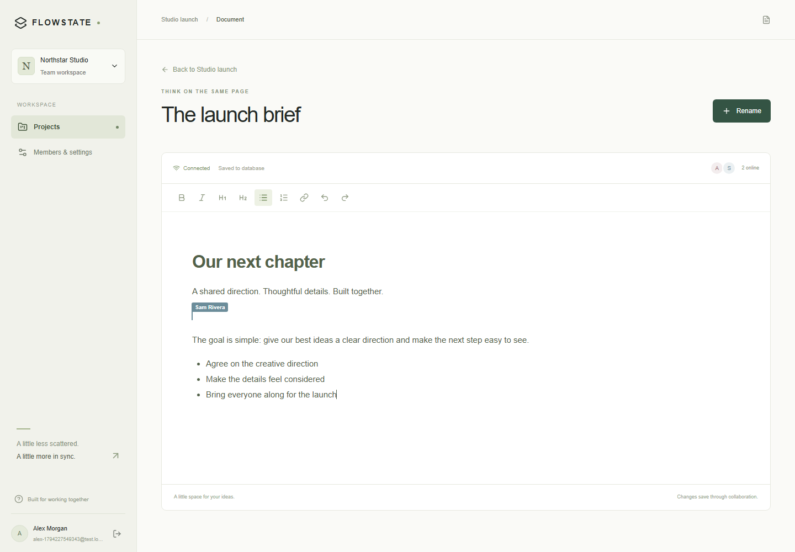
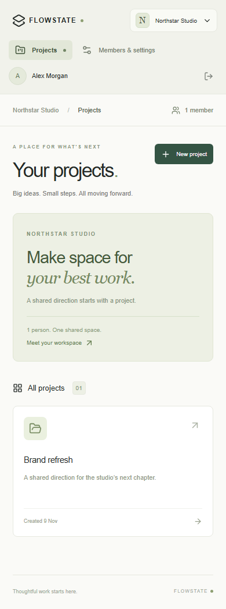

# FLOWSTATE

**A shared workspace for projects, boards and live documents.**

`main` is the stable foundation. The redesigned studio and advanced collaboration
features are developed on [version-2](https://github.com/Pranav-Teja-Aluvala/flowstate/tree/version-2).



## On this branch

- Email/password accounts, workspace roles and email-bound invitation links.
- Project boards with assignments, persistent ordering and task editing.
- Genuine two-user rich-text editing, live cursors and durable document state.
- Shared project files and selected-repository GitHub code sessions.
- Optional isolated Docker terminal, enabled only after operator setup.

The maintenance update keeps this interface stable, corrects Docker snapshot
transfer and terminal output framing, keeps shared code positions consistent across Windows line endings, simplifies
the repository presentation and
updates the source terms. Version 2's new UI, Office engine and reviews remain on
its own branch.





<details><summary>Mobile workspace</summary>



</details>

## Run locally

Use Node.js 24 and PostgreSQL. Follow the [native setup instructions](docs/local-development.md)
for environment configuration and the optional Docker stack.

```sh
npm ci
npm run db:migrate
npm run dev
# Another terminal:
npm run dev:collaboration
```

Open [localhost:3000](http://localhost:3000).
[GitHub setup](docs/github-setup.md) · [Code workspaces](docs/code-workspace.md) ·
[Verification record](docs/verification.md) · [Security](docs/security/model.md)

## Checks

```sh
npm run typecheck
npm run lint
npm run format:check
npm test
npm run build
npm run test:e2e
npm run test:code
# Requires Docker:
npm run test:docker
```

GitHub transport in browser tests uses isolated fixtures. No hosted deployment,
production security audit or automatic email delivery is claimed.

The current revision is public for inspection, with rights reserved under
[LICENSE](LICENSE). It is not an open-source contribution program. Previously
MIT-licensed copies retain their original terms; dependencies keep their licenses.
