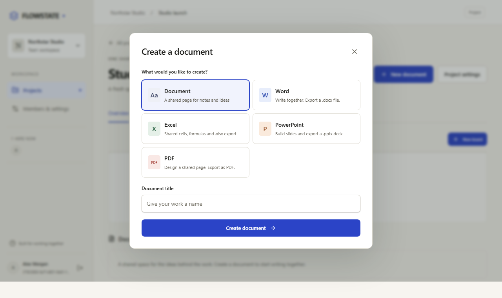
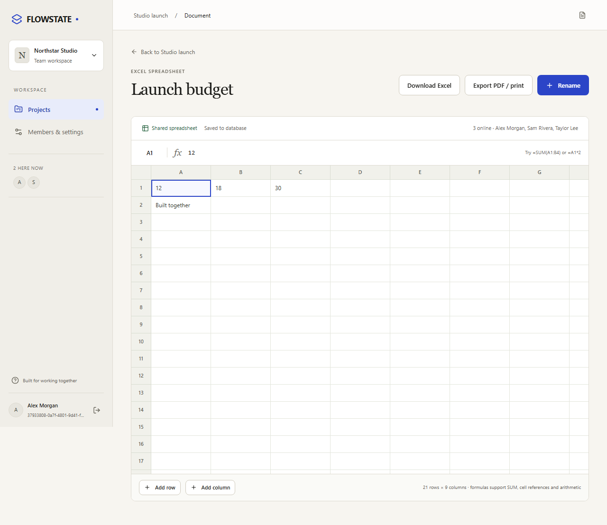
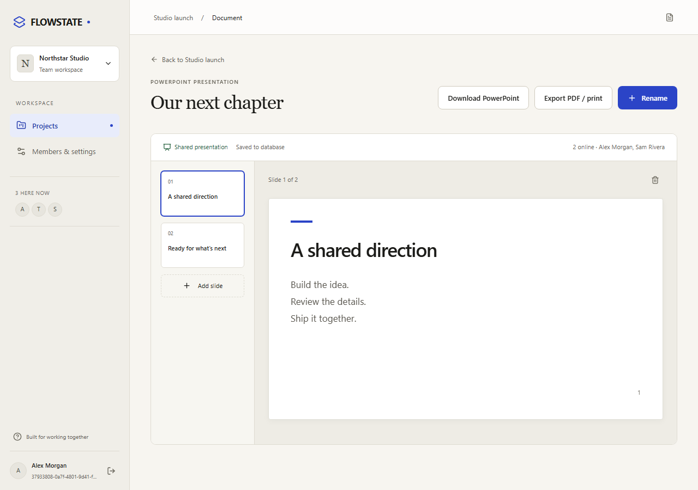

# Create documents in FLOWSTATE

From a project header or its Files page, choose **New document**, select a type,
name it, and create it. The editor opens immediately. New documents do not require
Docker, an Office server, a GitHub App or a paid account.

| Type            | Editing                                                            | Export                                                 |
| --------------- | ------------------------------------------------------------------ | ------------------------------------------------------ |
| Document / Word | Shared rich text, headings, bold/italic, lists and live cursors    | DOCX with basic formatting; browser PDF/print          |
| Excel           | Shared cell values, basic formulas, TSV paste, row/column addition | XLSX values/formulas/cached results; browser PDF/print |
| PowerPoint      | Shared slide titles/body text, add/select/delete slides            | PPTX deck; browser PDF/print                           |
| PDF             | A shared rich-text page for a new PDF                              | Browser PDF/print (choose Save as PDF)                 |

Word downloads include the document title and supported rich-text formatting.
Links export as their text; complex layout, tables and embedded images are not
provided by this native editor.

Spreadsheets start at 20 rows × 8 columns and support up to 100 rows × 26 columns,
500 characters per cell, decimal arithmetic, parentheses, cell references and
`SUM(A1:B4)`. Cycles and division by zero display errors. Expensive dependency graphs stop at a bounded calculation budget with `#LIMIT!`. Unsupported functions
are errors rather than executable scripts or external-data formulas. This is a
focused shared spreadsheet, not a full Excel replacement. An XLSX export requests
recalculation when opened; supported formulas also carry calculated results.

Presentations support up to 30 slides, 150-character titles and 4,000-character
body text. The native layout is deliberately consistent. Image editing, arbitrary
shape placement, speaker notes and PowerPoint animation are not implemented.

Edits use the same authenticated Yjs collaboration/persistence service as native
rich-text documents. Viewers are read-only. Exports require current membership
and use the latest saved state; wait for “Saved to database” before downloading.

These are newly created FLOWSTATE documents. Uploaded DOCX/XLSX/PPTX/PDF files stay
in the file library with their original bytes. Editing those uploads while keeping
the original layout requires the separately configured Office engine. When it is
missing, the file page explains the available download and native-creation paths
instead of presenting a failing editor as ready to use.
