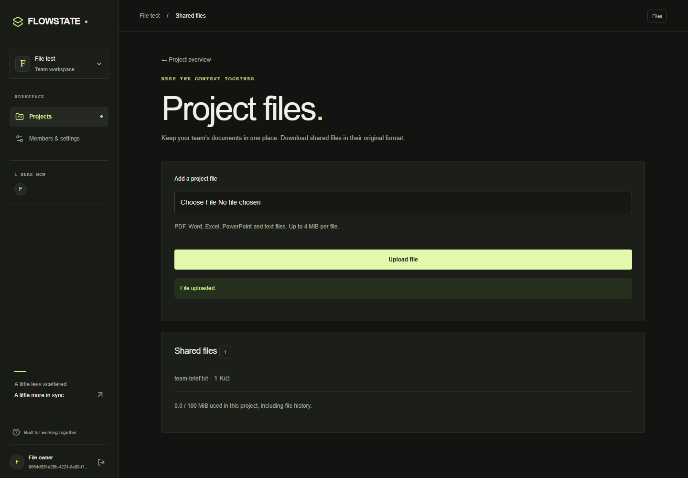

# Project file library

Project overview now links to **Files**. Workspace owners, administrators and editors can upload; all workspace members can download. Every download rechecks current membership. Files belonging to another workspace return 404. Downloads are attachments with private/no-store caching and nosniff headers.

Supported upload extensions: PDF, DOCX, XLSX, PPTX, TXT, MD and CSV. Limits are 4 MiB per file and 100 MiB per project, with concurrent upload quota checks serialized in PostgreSQL. Browser MIME types are not trusted. Basic PDF/ZIP signatures and UTF-8 text are checked; these checks do not validate complete Office archives, scan malware or guarantee that a file is safe. Files are not automatically executed, extracted or rendered as HTML.

This library preserves original file bytes for sharing and download. Version 2 adds an optional [office-editor integration](office-editing.md), including final-save history; real engine verification is still pending. Older binary DOC/XLS/PPT and macro-enabled files are not supported.

## Local storage

`FILE_STORAGE_PROVIDER=local` is the default. Development writes to `.local/files` at the repository root when Next runs from `apps/web`. Set an absolute `FILE_STORAGE_PATH` if launching differently. Compose uses a separate persistent `file-data` volume at `/app/.local/files`, writable by the application user. Back up this volume along with the database; database dumps alone do not contain uploaded file contents.

Storage keys contain generated project/file UUIDs. Uploaded filenames are metadata, never filesystem paths. Existing objects are not overwritten. Local storage is refused on Vercel because its filesystem is not durable for this purpose.

Deleting a project removes its file metadata through the database foreign key. Blob retention/garbage collection is not implemented yet, so inaccessible orphaned blobs may remain on disk or in the bucket. Include lifecycle cleanup in the next file-management milestone; do not assume project deletion frees provider storage immediately. An interrupted database commit after an object upload can also leave an orphan. No automated destructive cleanup runs.

## Supabase storage

Create a **private** bucket named `flowstate-files` and configure the web service's server environment:

```dotenv
FILE_STORAGE_PROVIDER=supabase
SUPABASE_URL=https://YOUR_PROJECT.supabase.co
SUPABASE_SERVICE_ROLE_KEY=YOUR_SERVER_ONLY_KEY
SUPABASE_STORAGE_BUCKET=flowstate-files
```

The service-role credential stays on the server. The application uses its own session and workspace authorization before using Storage. Do not publish the bucket or give anonymous clients bucket-wide read/write access. Storage service keys bypass Supabase RLS, so application authorization is essential. This adapter uses server-mediated uploads and downloads, not public file URLs.

When hosting the application tables in Supabase, also secure their Data API exposure. The current application uses direct PostgreSQL, not Supabase Auth; enabling generic authenticated-user policies would not reproduce FLOWSTATE's workspace rules. Disable unneeded Data API exposure or apply deny-by-default policies and use a dedicated trusted server database role. Do not deploy application tables publicly just because Storage is private.

The Supabase adapter has mocked HTTP coverage for request credentials, failed uploads and downloaded bytes; it has not been tested against a live account. Local storage and authorization have browser coverage. Both live hosted activation and office editing remain pending.


